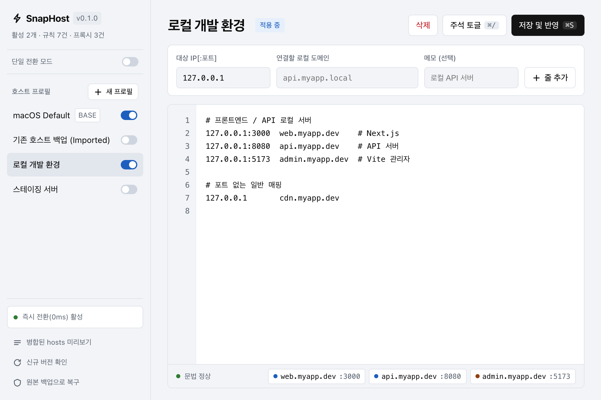
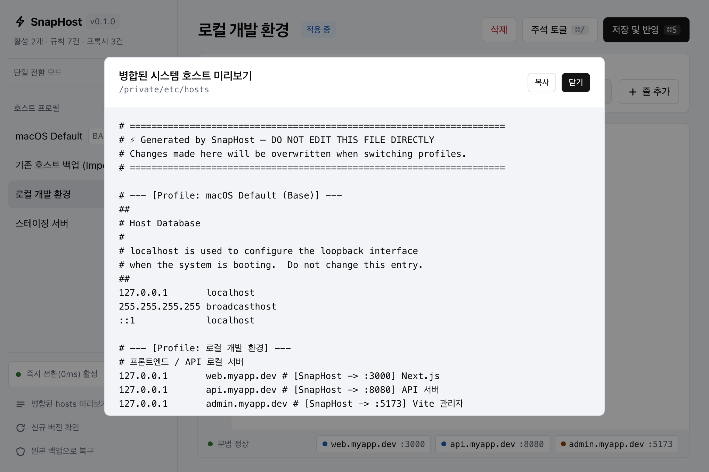
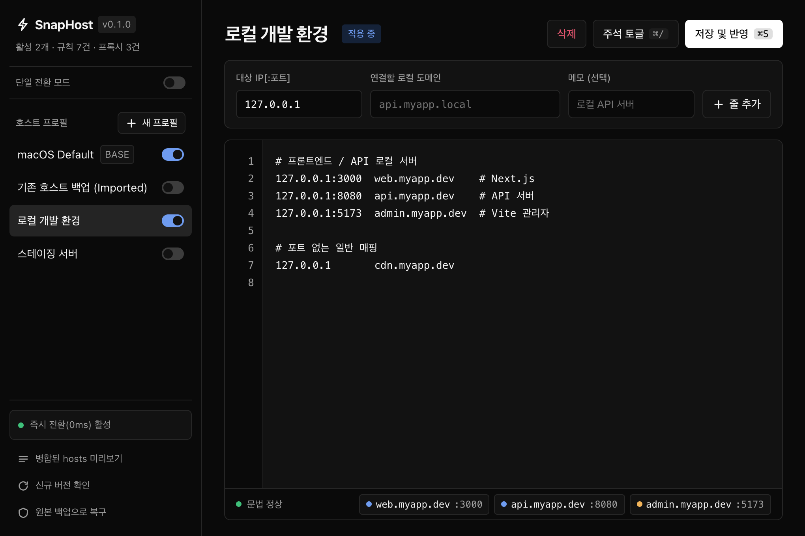

# SnapHost

**macOS용 무료 hosts 파일 관리 앱.** 개발·스테이징·로컬 환경별 hosts 설정을 프로필로 저장해 두고,
스위치 한 번으로 `/etc/hosts`를 바꿉니다. `127.0.0.1:3000 web.myapp.dev`처럼 **포트까지 지정한 로컬 도메인**도
내장 프록시가 연결해 줍니다.

- **무료**: 결제, 가입, 광고 없이 모든 기능을 쓸 수 있습니다. [MIT 라이선스](LICENSE)의 오픈소스입니다.
- **빠름**: Rust 엔진과 macOS 기본 WebKit으로 만들었고(Electron 아님), 설치 파일은 약 3MB입니다. 권한을 한 번 설정하면 이후 전환할 때 비밀번호를 묻지 않습니다.
- **안전**: 모든 데이터는 내 Mac 안에만 저장됩니다. 처음 실행할 때 원래 hosts 파일을 백업해 두고, 언제든 한 번에 되돌릴 수 있습니다.



> 요구 사항: Apple Silicon(M1 이상) Mac

---

## 주요 기능

| 기능 | 설명 |
| --- | --- |
| 프로필 전환 | hosts 설정을 프로필 단위로 저장하고, 스위치로 켜고 끕니다. 켜는 즉시 `/etc/hosts`에 반영되고 DNS 캐시가 초기화됩니다. |
| 병합 모드 / 단일 전환 모드 | 여러 프로필을 동시에 켜서 합쳐 쓰거나(기본), 하나만 켜지도록 할 수 있습니다. macOS 기본(Base) 프로필은 항상 유지됩니다. |
| 포트 매핑 | `127.0.0.1:3000  web.myapp.dev`처럼 포트를 적으면, 브라우저에서 `http://web.myapp.dev`로 바로 3000번 서버에 접속됩니다. |
| 포트 상태 표시 | 편집기 하단에 매핑된 도메인과 포트가 표시되고, 로컬 서버가 응답 중이면 파란 점, 꺼져 있으면 주황색 점으로 보여 줍니다. |
| hosts 편집기 | 줄 번호, 실시간 문법 검사, `⌘/` 줄 주석 토글, `⌘S` 저장·반영. 상단 입력 바로 IP·도메인·메모를 넣으면 형식에 맞춰 한 줄이 추가됩니다. |
| 병합 결과 미리보기 | 실제로 `/etc/hosts`에 기록될 최종 내용을 확인하고 복사할 수 있습니다. |
| 메뉴바 상주 | 창을 닫아도 메뉴바(⚡)에 남아, 에디터를 열지 않고도 프로필 전환과 DNS 캐시 초기화를 할 수 있습니다. |
| 원본 복구 | 처음 실행할 때 백업한 원래 hosts 파일로 한 번에 되돌립니다. |
| 자동 업데이트 | 실행 시 GitHub 릴리즈에서 새 버전을 확인하고, 앱 안에서 바로 설치할 수 있습니다. |
| 다크 모드 | macOS 화면 모드 설정을 따라갑니다. |



---

## 설치

1. [Releases](https://github.com/kwakchangkyoung/snaphost/releases/latest) 페이지에서 `SnapHost_x.x.x_aarch64.dmg`를 내려받습니다.
2. dmg를 열고 `SnapHost.app`을 `응용 프로그램(Applications)` 폴더로 끌어다 놓습니다.
3. 처음 실행합니다.

### "손상되었거나 확인할 수 없는 개발자" 경고가 뜨는 경우

현재 배포본은 Apple 개발자 인증서로 서명되어 있지 않아, macOS가 처음 실행을 막을 수 있습니다.
아래 둘 중 하나로 한 번만 허용하면 이후에는 바로 열립니다.

- 터미널에서 실행:
  ```bash
  xattr -cr /Applications/SnapHost.app
  ```
- 또는 `시스템 설정 > 개인정보 보호 및 보안` 하단의 **그래도 열기**를 누릅니다.

---

## 사용 방법

### 1. 즉시 전환 권한 설정 (최초 1회)

사이드바 하단에 **hosts 쓰기 권한 필요**가 보이면 **권한 설정**을 누르고 macOS 관리자 암호를 입력합니다.
설정이 끝나면 **즉시 전환(0ms) 활성**으로 바뀌고, 이후에는 프로필을 바꿀 때마다 암호를 묻지 않습니다.

> 권한을 설정하지 않아도 사용할 수 있습니다. 이 경우 hosts를 바꿀 때마다 macOS 암호 창이 뜹니다.

### 2. 프로필 켜고 끄기

- 사이드바의 프로필 오른쪽 스위치를 켜면 즉시 시스템에 반영됩니다.
- 메뉴바의 ⚡ 아이콘을 눌러도 같은 방식으로 전환할 수 있습니다.
- **단일 전환 모드**를 켜면 프로필 하나를 켤 때 나머지 프로필(Base 제외)이 자동으로 꺼집니다.

처음 실행하면 아래 세 프로필이 준비되어 있습니다.

| 프로필 | 내용 |
| --- | --- |
| macOS Default (Base) | macOS 기본 항목(`localhost` 등). 삭제할 수 없고 항상 포함됩니다. |
| 기존 호스트 백업 (Imported) | 설치 전에 쓰던 `/etc/hosts` 내용. 기존 설정을 잃지 않도록 가져온 것입니다. |
| 로컬 개발 환경 (Sample) | 일반 매핑과 포트 매핑 예시 |

### 3. 프로필 만들고 편집하기

1. 사이드바 **호스트 프로필** 옆의 **새 프로필**을 누르고 이름을 입력합니다.
2. 오른쪽 편집기에 hosts 형식으로 내용을 적습니다. 상단 입력 바에 `대상 IP[:포트]`, `연결할 로컬 도메인`, `메모`를 넣고 **줄 추가**를 눌러도 됩니다.
3. **저장 및 반영**(`⌘S`)을 누르면 저장과 동시에 시스템에 반영됩니다.

| 단축키 | 동작 |
| --- | --- |
| `⌘S` | 저장 및 반영 |
| `⌘/` | 선택한 줄 주석 토글 |

제목을 클릭하면 프로필 이름을 바꿀 수 있습니다. 저장하지 않은 채 다른 프로필로 옮기려 하면 확인 창이 뜹니다.
문법이 잘못된 줄은 편집기 하단에 몇 번째 줄인지 표시되고, 시스템 hosts에는 주석으로 처리되어 기록되므로 다른 설정을 망가뜨리지 않습니다.

### 4. 포트까지 지정해 로컬 도메인 쓰기

```text
# 일반 hosts 문법
127.0.0.1       local.myapp.dev

# SnapHost 포트 매핑
127.0.0.1:3000  web.myapp.dev    # Next.js
127.0.0.1:8080  api.myapp.dev    # API 서버
```

- 포트가 붙은 줄은 `/etc/hosts`에 `127.0.0.1 web.myapp.dev` 형태로 기록되고,
  SnapHost 내장 프록시(`127.0.0.1:80`)가 요청의 도메인을 보고 지정한 포트로 넘겨 줍니다.
- 브라우저에서 `http://web.myapp.dev`로 접속하면 됩니다. WebSocket도 그대로 전달되어 Vite·Next.js의 HMR이 동작합니다.
- 80번 포트를 다른 프로그램이 쓰고 있으면 프록시는 `8880` 포트로 열립니다. 이때는 `http://web.myapp.dev:8880`으로 접속합니다.
- HTTP만 지원합니다(HTTPS 프록시는 지원하지 않습니다).

### 5. 문제가 생겼을 때 되돌리기

사이드바 하단의 **원본 백업으로 복구**를 누르면, SnapHost를 처음 실행할 때 백업해 둔 원래 `/etc/hosts`로 즉시 되돌아갑니다.
메뉴바의 **DNS 캐시 즉시 초기화**로 캐시만 따로 비울 수도 있습니다.



---

## 보안과 개인정보

- **내 Mac 안에서만 동작합니다.** 계정, 서버, 사용 통계 수집이 없습니다. 앱이 외부로 보내는 요청은 GitHub 릴리즈에서 새 버전을 확인하고 내려받는 것뿐입니다.
- **프록시는 외부에 열리지 않습니다.** 내장 프록시는 `127.0.0.1`(내 컴퓨터)에서만 요청을 받으므로 같은 네트워크의 다른 기기에서는 접근할 수 없습니다.
- **암호를 저장하지 않습니다.** 관리자 권한이 필요할 때는 macOS 기본 인증 창을 사용하고, SnapHost는 암호를 보거나 저장하지 않습니다.
- **원본이 보존됩니다.** 첫 실행 때 원래 hosts 파일을 백업하고 기존 내용을 프로필로 가져오므로 기존 설정이 사라지지 않습니다.
- **Rust로 작성되었습니다.** 메모리 안전성이 보장되는 언어로 hosts 파싱과 프록시를 처리합니다.
- **오픈소스입니다.** 앱이 하는 일을 이 저장소의 코드로 직접 확인할 수 있습니다.

### 즉시 전환 권한이 바꾸는 것

**권한 설정**은 `/etc/hosts` 파일의 소유자를 현재 사용자로 바꾸고 권한을 `664`로 설정합니다
(`chown <사용자>:staff`, `chmod 664`). 그래서 이후에는 암호 없이 파일을 쓸 수 있습니다.
바뀌는 대상은 이 파일 하나뿐이지만, 같은 Mac의 다른 프로그램도 hosts 파일을 수정할 수 있게 된다는 뜻이기도 합니다.
원래 상태로 되돌리려면 터미널에서 실행합니다.

```bash
sudo chown root:wheel /etc/hosts && sudo chmod 644 /etc/hosts
```

---

## 데이터 위치와 삭제

| 항목 | 위치 |
| --- | --- |
| 프로필·설정 | `~/Library/Application Support/com.snaphost.app/profiles.json` |
| 원본 hosts 백업 | `~/Library/Application Support/com.snaphost.app/original_hosts.bak` |

앱을 완전히 지우려면:

1. 앱에서 **원본 백업으로 복구**를 눌러 hosts를 원래대로 돌립니다.
2. 메뉴바 ⚡ > **SnapHost 종료**로 앱을 끕니다.
3. `/Applications/SnapHost.app`과 위의 `com.snaphost.app` 폴더를 삭제합니다.
4. 즉시 전환 권한을 설정했었다면 위의 `chown`/`chmod` 명령으로 권한을 되돌립니다.

---

## 직접 빌드하기

Rust 1.85 이상(stable, edition 2024)이 필요합니다.

```bash
git clone https://github.com/kwakchangkyoung/snaphost.git
cd snaphost

# 코어 엔진 테스트
cargo test -p snaphost-core

# 앱 실행
cargo run -p snaphost-app
```

| 경로 | 내용 |
| --- | --- |
| `crates/snaphost-core` | hosts 파서, 프로필 병합, 시스템 반영·백업, 로컬 프록시, 업데이트 확인 |
| `src-tauri` | Tauri v2 앱 셸, 메뉴바, 명령 연결 |
| `ui` | 편집기 화면(HTML/CSS/JS) |

`v*` 형식의 태그를 푸시하면 GitHub Actions가 `.app`과 `.dmg`를 빌드해 릴리즈에 올립니다.

---

## 라이선스

[MIT](LICENSE)
